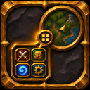

# Compact Addon Buttons



A minimap button drawer for World of Warcraft: Forever, Interface 16001. It has no required libraries and no required addons.

## Installation

Copy the entire `CompactAddonButtons` directory into the Forever client's `Interface/AddOns/` directory. The manifest must be at `Interface/AddOns/CompactAddonButtons/CompactAddonButtons.toc`, with no extra directory wrapped around it. Restart the client or reload the UI, then enable Compact Addon Buttons in the addon list.

The `tests` directory and this README are development files. You can leave them out of an install.

## Controls

| Action | Result |
| --- | --- |
| Left-click the addon button on the minimap | Toggle a compact icon popup beside the button |
| Right-click the addon button | Open the exceptions list |
| Drag the addon button | Move it around the minimap edge |
| Drag the settings header | Move the settings window |
| Check a button in Exceptions | Keep that button on the minimap |
| Language dropdown in settings | Choose automatic detection or a specific interface language |
| Buttons per row dropdown in settings | Choose 1 to 12 columns (default: 6); saved per account |
| Search in settings | Filter the exceptions list by button name |
| Refresh in settings | Immediately discover newly created buttons |
| Escape or left-click the addon button again | Close the popup |
| `/cab` or `/compactaddonbuttons` | Toggle the drawer |
| `/cab settings` | Toggle the exceptions list |
| `/cab refresh` | Rescan buttons |

The popup shows addon icons in a tight grid on a lightly translucent background. Its size follows the visible buttons: 1 to 12 columns, six by default, and as many rows as the buttons need. The icon grid does not scroll. Right-click the launcher and choose Buttons per row to change the grid without reloading. The popup sits beside the launcher, opens toward the interior of the screen, and is kept inside the screen edges. Names and help come from the original button tooltips. Search and exception controls are in the larger settings view, opened with a right-click. That window's position is saved on its own. Only the settings list scrolls.

Settings, the language preference, exceptions, and the settings-window and minimap positions are saved per account. The window uses game fonts, native controls, a dark background, and a thin muted gold border.

The minimap launcher uses `Media/MinimapIcon.tga`: four gold-framed buttons in a compact 2 x 2 grid, drawn simply so the small launcher stays readable. The uncompressed 64 x 64, 32-bit RGBA texture keeps the transparent corners and gaps (16,428 bytes). The in-game addon list uses `Media/Icon.tga`, the original uncompressed 64 x 64, 24-bit RGB artwork (12,332 bytes). `icon.png` and `minimap-icon.png` are 128 x 128 documentation previews. The game does not load them.


## Languages

English is the default and the fallback. On first use, the language preference is Automatic (client language). The bundled translations are:

| Language | Client locales |
| --- | --- |
| English | `enUS`, `enGB` |
| Russian | `ruRU` |
| Spanish | `esES`, `esMX` |
| German | `deDE` |
| French | `frFR` |

Right-click the minimap button, then use Language to override automatic detection. A manual choice is saved per account and updates the open interface without a reload. An unsupported client language uses English. A missing translation key falls back to English on its own.

Each language is a UTF-8 Lua file under `Locales/`. To bundle another language, register its strings in a new file and add that file to the manifest after `Locales/enUS.lua`. The rest of the addon stays as it is:

```lua
local _, ns = ...
ns.Localization.Register("itIT", "Italiano", {
    TITLE = "Pulsanti addon",
    LANGUAGE = "Lingua",
    AUTO_LANGUAGE = "Automatico (lingua del client)",
    -- Omitted keys use English. See Locales/enUS.lua for the full dictionary.
})
```

Another addon can call `CompactAddonButtons.RegisterLocale(locale, displayName, strings, aliases)` after this addon loads. Registering more strings for a locale that already exists merges them and does not add a second language menu entry. An optional aliases array maps extra client locales onto the translation. Strings and language metadata are copied on registration. Translations must be strings. An invalid registration returns `false` and leaves the registry unchanged. Registration also refreshes the current interface, so a translation pack that loads late still applies.

`CompactAddonButtons.SetLanguage("frFR")` selects a registered language. `SetLanguage("auto")` restores client detection. `GetLanguage()` returns the effective canonical locale. An unsupported manual selection returns `false` and leaves the saved preference unchanged.

## Code organization

Modules are plain Lua tables. Each one has a stated job. There is no framework and no class hierarchy.

| Module | Responsibility |
| --- | --- |
| `Buttons.lua` | Button identities, duplicate prevention, ordering, and matching; no frame operations |
| `Collection.lua` | Capture/restore button state and maintain collected anchors |
| `Discovery.lua` | Discover LibDBIcon/custom buttons and exclude native/protected controls |
| `Settings.lua` | Saved variables, validation, persistence, and migration |
| `Localization.lua`, `Locales/` | Translation registry, locale resolution, English fallback, dictionaries |
| `UI/Window.lua` | Render the compact popup and settings; dispatch user actions |
| `UI/MinimapButton.lua` | Launcher appearance, minimap geometry, dragging, and tooltips |
| `UI/Widgets.lua` | Shared frame styling and small widget factories |
| `Application.lua` | Coordinate discovery, collection, preferences, and combat restrictions |
| `Bootstrap.lua`, `API.lua` | WoW events, slash commands, and the public extension API |

## How collection works

The drawer reparents the original button into a grid cell and places it above the popup panel, so the panel cannot take the click. Left-click, right-click, hover tooltips, and the button's other original scripts still belong to the source addon. Drag scripts are turned off while the button is in the drawer and restored when the button becomes an exception. The original parent, frame strata, frame level, and every anchor point are restored too, so an excluded button gets its minimap stacking order back immediately. Buttons are not resized. A button hidden by its source addon is not forced on screen.

Discovery uses an already loaded `LibDBIcon-1.0` when that library is present, then searches the minimap and the minimap backdrop for named addon icon buttons, including nested minimap buttons. A scan every two seconds picks up delayed creation and load-on-demand addons. Names from LibDBIcon are the stable exception identities. An exception found before LibDBIcon loads is moved to its library identity when that is possible.

Game controls stay out, including tracking, mail, zoom, queue status, the clock, and the world map. Protected buttons stay out. An anonymous button, or a custom button in an unusual place, may need its addon to register it. An arbitrary UI frame cannot be told apart from a game control with any confidence. Turn off other minimap button collectors so they do not fight this one over parents and anchors.

The drawer closes when combat starts. Opening it, and changing button parents or anchors, waits until combat ends. The launcher stays on the minimap. Trying to open the drawer during combat prints a short explanation.

## Optional registration API

An addon with an unusual minimap button can register it after Compact Addon Buttons has loaded:

```lua
if CompactAddonButtons then
    CompactAddonButtons.RegisterButton("MyAddon", "My Addon", myMinimapButton)
end
```

The key should be stable and unique. Registration accepts a call made before login, ignores a duplicate button object, and rejects a protected button. LibDataBroker and LibDBIcon are not required.

## Verification

From the repository root, with Python 3.12:

```powershell
python -m pip install -r CompactAddonButtons/tests/requirements.txt
python CompactAddonButtons/tests/run.py
```

The runner also accepts the repository-local `.tools/lua-test-runtime` installation. It loads the addon manifest in Lua 5.1 against a stateful UI double. Sixteen scenarios cover all five bundled languages, the English and Spanish locale aliases, an unsupported client language, and both fresh and migrated settings.

The suite covers startup and invalid saved settings, LibDBIcon and custom discovery, exclusion of native and protected controls, hidden buttons, original click and hover behavior, repositioning, exception restoration with several anchors and drag scripts, identity migration, periodic scans, search, slash commands, saved positions, square minimaps, popup bounds, and combat deferral. Localization checks cover the dropdown callbacks, immediate text updates, per-key fallback, complete bundled dictionaries, persistence of a manual choice, invalid registrations, metadata isolation, late translation packs, and a language change during combat.

Run a live Forever client check as well. The harness has not verified visual layout, real third-party callbacks, or client taint and protection. Before a release:

1. Confirm `/dump select(4, GetBuildInfo())` reports `16001`.
2. Enable several installed addons with minimap buttons. Only this addon's button, plus the exceptions you chose, should remain on the minimap.
3. Open the drawer and test each collected button's left-click, right-click, and tooltip.
4. Toggle exceptions, move the settings window and the launcher, reload, and check that those choices persist. The icon popup should still open beside the launcher, not at the saved settings position.
5. Test a source addon's own show and hide setting, and a load-on-demand button.
6. Enter and leave combat with the drawer open. Watch for Lua errors, blocked actions, and taint.
7. With more than 36 buttons and with different column counts, the icon grid should grow and still not scroll. Also check settings-list scrolling, an empty popup, Russian text, custom minimap shapes, a launcher near each screen edge, and the client's UI scale.
8. Select each language in the native dropdown. Check translated labels and tooltips for clipping, reload, and confirm the choice persists. Switch back to automatic detection.
